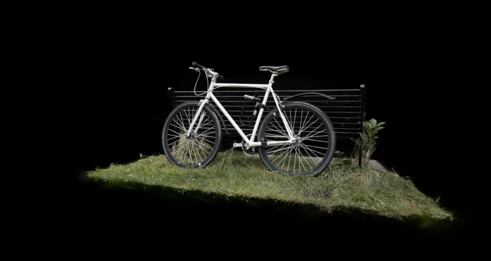
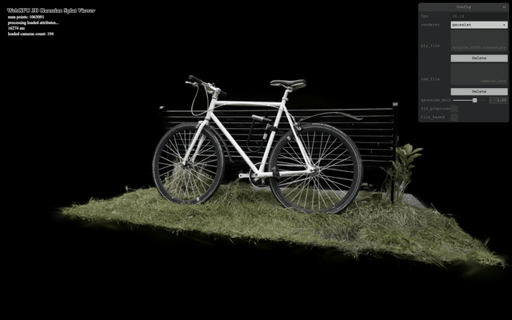
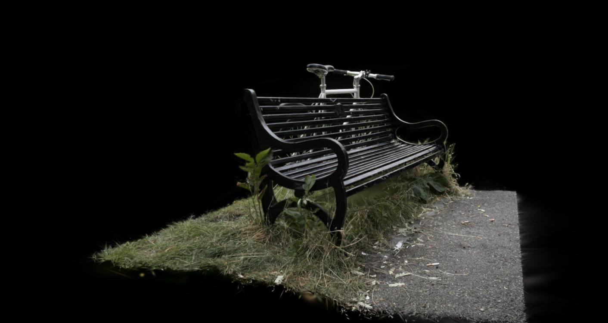

WebGPU Gaussian Splat Viewer
============================

**University of Pennsylvania, CIS 5650: GPU Programming and Architecture, Project 5**

* Ximing Luo
* Tested on: Google Chrome 155.0.8059.85 on Windows 11 Home, AMD Ryzen 9 8945HS @ 4.0GHz 32GB, NVIDIA GeForce RTX 4070 Laptop GPU 8GB (personal laptop)

### Live Demo

[](https://ximluo.github.io/Project5-WebGPU-Gaussian-Splat-Viewer)

Needs a WebGPU browser. Load a `.ply` scene and its `cameras.json` from the panel, then set the renderer to `gaussian`. Keys 0 to 9 jump to camera presets, left drag rotates, right drag pans, the wheel moves forward and back.

### Demo Video/GIF



## Overview

A 3D Gaussian splat viewer that runs entirely in WebGPU compute and render passes. Scenes are the pretrained `.ply` files from the 3D Gaussian Splatting paper.

* **Point cloud renderer.** Every Gaussian centre as a yellow point, used to check the camera and the data.
* **Gaussian renderer.** A compute preprocess projects each Gaussian to a 2D conic, a GPU radix sort orders the visible ones by depth, and one indirect instanced draw blends a quad per splat back to front.
* **Tile based sorting with compute compositing** (extra credit). Each Gaussian is duplicated into every 16 x 16 tile it touches, the copies are sorted by tile and depth in one radix sort, and a compute shader composites each tile front to back straight into the canvas.
* **Half precision preprocess** (extra credit). A second preprocess shader with `enable f16` that reads the f16 scene data natively and evaluates colour and shape in half precision.

Panel controls: `renderer`, the `gaussian_multiplier` scale slider, and the `f16_preprocess` and `tile_based` checkboxes. All four combinations can be switched while the scene runs.

| | | |
|:--:|:--:|:--:|
|  |  |  |
| bicycle, camera 0 | bicycle, camera 4 | bonsai |

## Running it

```
npm install
npm run dev
```

Open the printed localhost address in Chrome, pick a `.ply` in `ply_file` and the matching `cameras.json` in `cam_file`, then set `renderer` to `gaussian`. Scene files come from the course Drive folder linked in `INSTRUCTION.md`; `bicycle_30000.cleaned.ply` and `bonsai.ply` were used here. `npm run build` produces the static site that the GitHub Pages workflow deploys.

## How it works

**Preprocess (`preprocess.wgsl`).** One compute thread per Gaussian. It unpacks the f16 position, opacity (sigmoid of the stored logit), quaternion and log scales, projects the centre, and culls when NDC z is outside [0, 1] or |x| or |y| is above 1.2 so splats just past the screen edge still draw. The 3D covariance is `R S S^T R^T` from the normalised quaternion and `exp(scale) * gaussian_multiplier`; it is projected to 2D with `J W Sigma W^T J^T` (perspective Jacobian in pixels, view rotation) plus 0.3 on the diagonal. The inverse of that 2 x 2 matrix is the conic, the larger eigenvalue gives the radius (`3 sqrt(lambda)` pixels), and the colour comes from the spherical harmonics in the direction from the camera. The thread stores a 24 byte `Splat` (centre and radius in NDC, conic, opacity, colour, packed as f16 pairs), reserves a slot in the sorter with `atomicAdd`, bumps the sort's indirect dispatch count once per 3840 keys, and writes its key and index.

**Sort.** The provided radix sort is ascending on 32 bit keys. The quad path uses `~bitcast<u32>(depth)`: flipping the bits of a positive float reverses its order, so the ascending sort comes out far to near. The visible count is copied from the sort info buffer into the indirect draw buffer, so the draw call never involves the CPU.

**Render (`gaussian.wgsl`).** Each instance reads its splat through the sorted index list and emits a four vertex strip around the centre. The fragment shader takes the pixel offset from the centre, evaluates `exp(-1/2 d^T conic d)`, multiplies by opacity (clamped at 0.99), discards below 1/255, and blends with `src-alpha / one-minus-src-alpha`.

**Tile path (`preprocess_tile`, `composite.wgsl`).** Same projection, then the tile rectangle covered by the radius. Keys are the tile id in the high bits and the top bits of the depth float in the rest (19 depth bits at 1080p), reserved as one contiguous range per Gaussian and clamped to the tile sorter's capacity of 4 keys per Gaussian. The compositor runs one 16 x 16 workgroup per tile: thread 0 binary searches the sorted keys for the tile's range, the workgroup loads 256 splats at a time into shared memory, and each pixel accumulates `color += c * alpha * T`, `T *= 1 - alpha` front to back until `T` drops below 0.0001. It writes the canvas as an `rgba8unorm` storage texture.

**Half precision (`preprocess_f16.wgsl`).** `Gaussian` is three `vec4<f16>`, the SH buffer is an `array<f16>`, and the `Splat` is written as f16 vectors with the same byte layout as the packed version. Spherical harmonics, the sigmoid, the quaternion and the scale run in f16; the projection, Jacobian, 2D covariance and conic stay f32 because pixel unit values overflow a half float.

## Performance Analysis

Setup: `bicycle_30000.cleaned.ply` (1,063,091 Gaussians) and `bonsai.ply` (272,956 Gaussians), camera preset 0 unless stated, canvas 1424 x 703, frame rate counted over 3 s of `requestAnimationFrame` callbacks. The display refreshes at 120 Hz, so 120 fps means the renderer is faster than the display.

| Scene | Point cloud | Quads, f32 | Quads, f16 | Tiles, f32 | Tiles, f16 |
|---|---|---|---|---|---|
| bicycle | 120 (capped) | 107 | 109 | 69 | 68 |
| bonsai | 120 (capped) | 120 (capped) | 120 (capped) | 120 (capped) | 120 (capped) |

**Point cloud vs Gaussian renderer.** The point cloud is one draw of a million points with a trivial shader and no sorting; it sits at the display cap on both scenes. The Gaussian renderer adds a compute pass over every Gaussian, four radix sort passes over the visible keys, and a blended quad per visible splat, and lands at 107 fps on bicycle. Skipping only the sort pushes the quad path back to the 120 cap, and shrinking every splat to 1 percent of its size (which removes almost all fragment work) changes nothing (103 vs 107 fps), so on this GPU the sort is the dominant cost, the fragment work is small at this view, and the preprocess is cheap. Visually the point cloud shows holes and no colour, while the splats produce the continuous, view dependent image.

**Workgroup size.** The preprocess workgroup size was changed together with the keys per thread constant so each sort dispatch still covers 3840 keys.

| Preprocess workgroup | Quads, f32 | Quads, tiny splats | Tiles, f32 |
|---|---|---|---|
| 64 | 105 | 102 | 60 |
| 128 | 103 | 109 | 69 |
| 256 | 107 | 103 | 69 |

The differences are within run to run noise. The preprocess is a million independent threads with no shared memory, so any of these sizes fills the GPU completely; the workgroup size only changes how the same threads are grouped, and the passes that take the time (the sort and the compositor) do not depend on it. The sort workgroups are fixed at 256 threads by the provided shader.

**View frustum culling.** Culling was disabled by marking every Gaussian visible.

| View | Quads, culled | Quads, no cull | Tiles, culled | Tiles, no cull |
|---|---|---|---|---|
| preset 0, whole scene in view | 107 | 100 | 69 | 60 |
| close to the bike, part of the scene off screen | 51 | 42 | 68 | 57 |

Culling helps, and more so when more of the scene is outside the frustum: every culled Gaussian is one key less to sort and one instance (or several tile copies) less to draw. At preset 0 most of the scene is in view, so the gain is about 7 percent; closer in it is about 20 percent. Culled Gaussians cost nothing downstream because the preprocess compacts the visible ones with `atomicAdd` and sizes the sort dispatch and the indirect draw from that count.

**Number of Gaussians.** Bonsai has a quarter of the Gaussians of bicycle and every mode is at the display cap, while bicycle is at 107 fps for quads. The work per frame is linear in the number of visible Gaussians: one preprocess thread each, four sort passes over the keys, and one quad each. The tile path adds the tile duplication on top, which is why it falls further behind on the larger scene (69 fps). The count also sets the memory: 24 bytes of splat data per Gaussian plus two sorters with 1 and 4 keys per Gaussian.

**Tiles vs quads.** At normal views the tile path is slower here: the sort handles two to four times as many keys and the compositor walks every splat in a tile for every pixel of that tile. It wins where the quad path drowns in overdraw. With the camera pushed into the grass, where a few huge splats cover the whole screen, quads drop to 24 fps while the compositor holds 87 fps, because each pixel stops as soon as its transmittance is used up.

**f16 preprocess.** No measurable difference on either path. The preprocess is not the bottleneck, and most of its time is memory traffic that the f16 loads already minimise in both variants; the arithmetic that moved to half precision is a small share of the frame.

## Credits

- [Vite](https://vitejs.dev/)
- [tweakpane](https://tweakpane.github.io/docs//v3/monitor-bindings/)
- [stats.js](https://github.com/mrdoob/stats.js)
- [wgpu-matrix](https://github.com/greggman/wgpu-matrix)
- Special Thanks to: Shrek Shao (Google WebGPU team) & [Differential Guassian Renderer](https://github.com/graphdeco-inria/diff-gaussian-rasterization)
- [3D Gaussian Splatting paper](https://repo-sam.inria.fr/fungraph/3d-gaussian-splatting/), [kwea123's notes](https://github.com/kwea123/gaussian_splatting_notes), [spherical harmonics post](https://beatthezombie.github.io/sh_post_1/)
