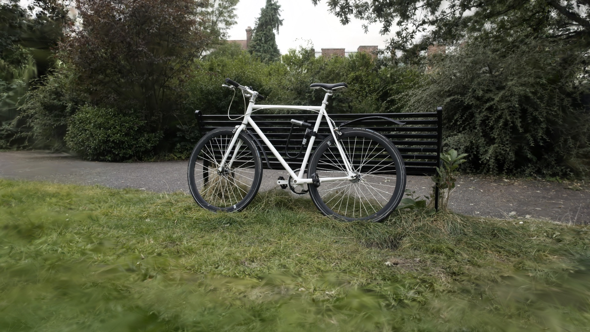
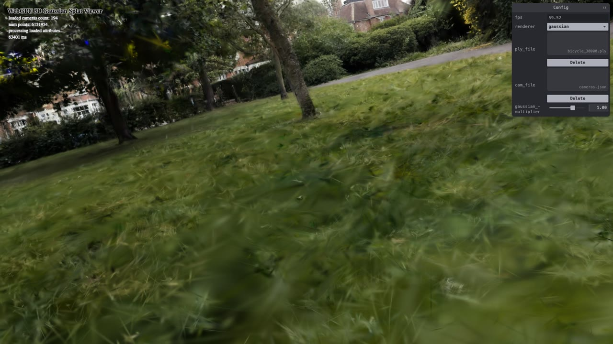
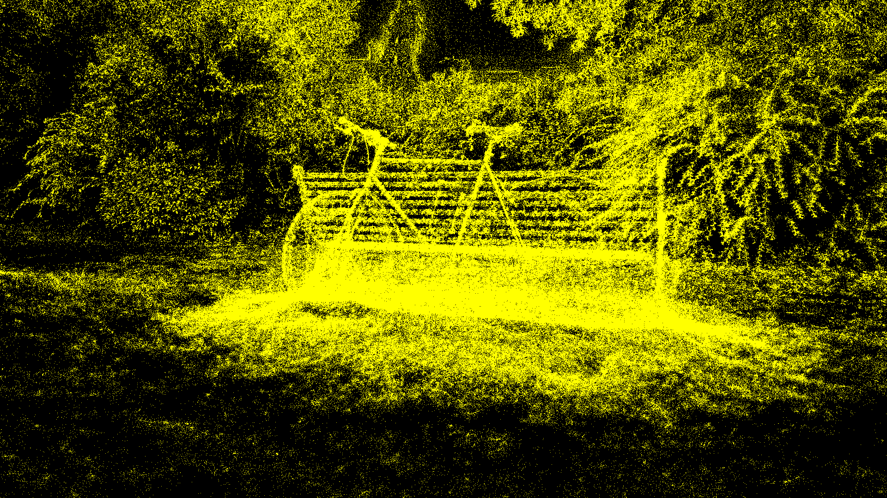
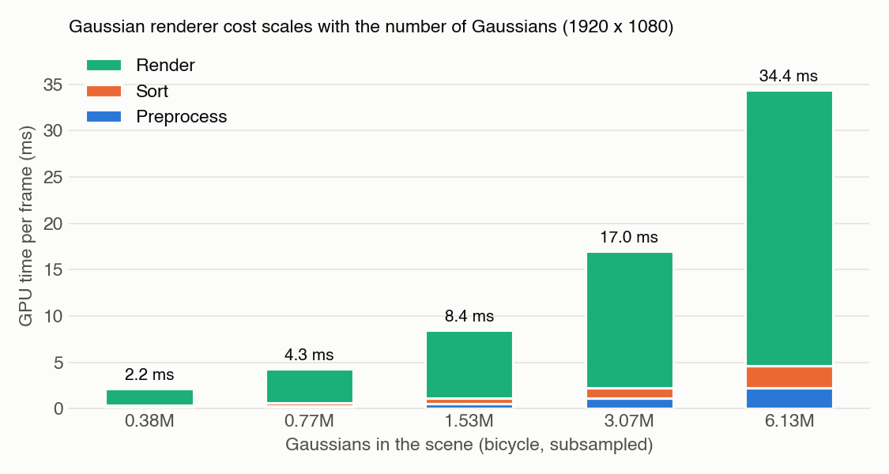
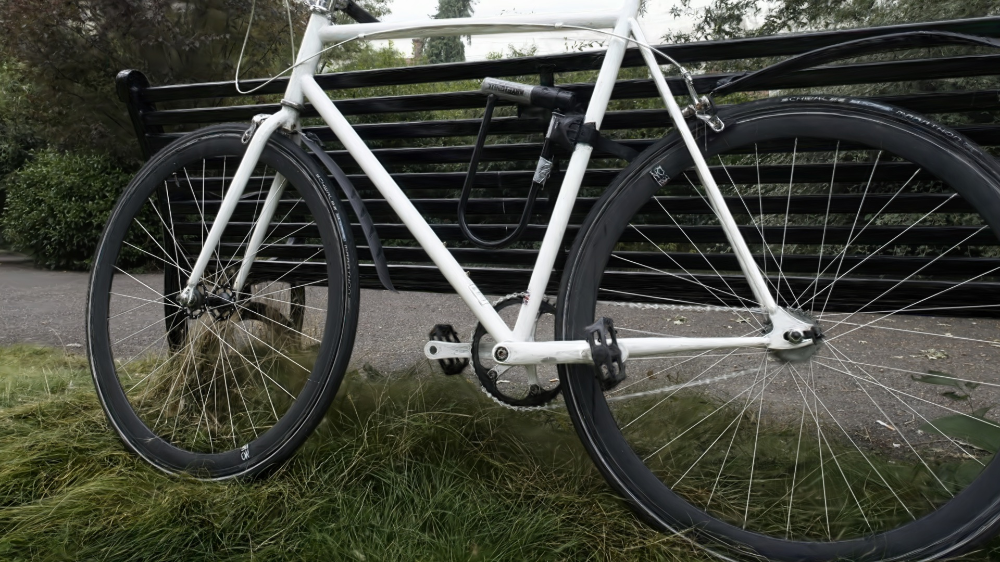

WebGPU Gaussian Splat Viewer
============================

**University of Pennsylvania, CIS 5650: GPU Programming and Architecture, Project 5**

* Hangyu Zhang
* Tested on: Google Chrome 156 on macOS 15.7, Apple M4 Pro (20-core GPU), 48 GB

### Live Demo

https://otaku-hy.github.io/Project5-WebGPU-Gaussian-Splat-Viewer/

Load a `.ply` scene and its `cameras.json` in the panel. Left drag rotates, right drag pans, the wheel moves forward/back, and keys 0-9 jump to camera presets.

### Demo Video

## Features

- **Point cloud renderer**: MVP transform in the vertex shader.
- **Gaussian renderer**, all on the GPU (preprocess, sort, draw):
  - **Preprocess** (compute, one thread per Gaussian): view-frustum culling (near plane + 1.2x NDC box), 3D covariance from rotation and scale (times the Gaussian multiplier), 2D covariance through the projection Jacobian, conic and 3σ radius, color from degree-3 spherical harmonics, sigmoid opacity. Visible Gaussians are compacted with `atomicAdd` into 32-byte splats (center and conic in f32; size, color and opacity packed as f16).
  - **Sort**: depth keys go to the provided radix sort, back to front. The preprocess pass also grows the sort's indirect dispatch size.
  - **Draw**: one indirect draw whose instance count is the visible-splat counter, copied on the GPU. The vertex shader builds a quad from the sorted splat; the fragment shader evaluates the Gaussian with the conic and blends with premultiplied alpha.
- **Gaussian multiplier** slider, bound to a uniform buffer.
- Small fixes: requested the adapter's `maxBufferSize` so the full `bicycle_30000.ply` loads (its SH buffer is 590 MB, above the 256 MB default), and dispatched the preprocess pass in 2D so it stays under the 65,535 workgroups-per-dimension limit for any scene size.

| Point cloud | Gaussian |
|---|---|
|  |  |

Note: the provided `bonsai.ply` doesn't line up with its `cameras.json` (the presets start close to the tablecloth). Scroll back to see the tree.

## Performance Analysis

All numbers are GPU times at 1920 x 1080, on `bicycle_30000.ply` (6.13M Gaussians) from camera preset 0 unless noted. I drove headless Chrome with a script that renders frames back to back (no vsync) and timed every pass with timestamp queries (median of 40 frames). The laptop was on battery and absolute times drifted between sessions, so everything below comes from one session with all comparisons interleaved (two rounds, which agreed within 1%).

### Point cloud vs. Gaussian

| Scene | Gaussians | Point cloud | Gaussian |
|---|---:|---:|---:|
| bicycle | 6.13M | 5.6 ms | 34.4 ms |
| bicycle (cleaned) | 1.06M | 2.1 ms | 18.8 ms |
| bonsai (zoomed out) | 0.27M | 0.35 ms | 3.1 ms |

- **Image**: the point cloud draws each Gaussian center as a 1-pixel yellow dot, with no size, color or opacity, so surfaces have holes. The Gaussian renderer draws each one as an oriented, view-dependent, semi-transparent ellipse, blended in depth order, which gives a continuous, photo-like image.
- **Cost**: the Gaussian renderer is 6-9x slower. The point cloud is one draw of single pixels, with no sorting or blending. In the Gaussian frame, preprocess and sort take about 2.3 ms each, and rendering takes 29.8 ms (87%): every visible splat is a quad up to its 3σ radius, and every covered pixel evaluates an `exp` and blends. With heavy overdraw, the renderer is limited by fragment work.

### Workgroup size (preprocess)

| Workgroup size | 16 | 32 | 64 | 128 | 256 | 512 | 1024 |
|---|---:|---:|---:|---:|---:|---:|---:|
| Preprocess (ms) | 2.36 | 2.28 | 2.27 | 2.27 | 2.27 | 2.28 | 2.28 |

- **No measurable effect** from 32 to 1024; the whole frame stays at 34.4 ms. Each thread is independent (no shared memory, no barriers), so the workgroup size only changes how threads are grouped for scheduling. The kernel is limited by memory: each visible Gaussian reads 120 bytes (mostly SH) and writes 40.
- **16 is about 4% slower.** Apple GPUs run 32-wide SIMD groups, so a 16-thread workgroup leaves half of each group idle.
- 512 and 1024 need a higher `maxComputeInvocationsPerWorkgroup` limit than the default 256. The app uses 256.

### View-frustum culling

"Off" disables only the screen-space test. The near-plane test always stays on, because the projection is invalid behind the camera.

| View | Splats drawn (on / off) | On | Off | Time saved |
|---|---:|---:|---:|---:|
| Default | 2.42M / 4.31M | 34.4 ms | 41.0 ms | 16% |
| Close-up (moved toward the bike) | 1.74M / 3.77M | 76.3 ms | 82.8 ms | 8% |
| Cleaned bicycle (whole scene in view) | 1.06M / 1.06M | 18.8 ms | 18.8 ms | 0% |

- **Yes, when part of the scene is off screen.** In the default view, culling skips 44% of the splats. Preprocess drops from 3.46 to 2.28 ms (culled threads exit before the covariance and SH work), the sort from 4.30 to 2.32 ms (half the keys), and rendering from 33.1 to 29.8 ms.
- **The gain is smaller than the splat reduction** because rendering dominates, and off-screen quads were already cheap: they cost vertex work and clipping, but no fragments. In the close-up, large on-screen splats dominate even more (8%). When everything is in view, nothing gets culled.

### Number of Gaussians

To vary the count on the same scene, I kept every 2nd, 4th, 8th and 16th Gaussian of `bicycle_30000.ply`.

- **Yes, cost is linear in the number of Gaussians**: 2.2 ms at 0.38M up to 34.4 ms at 6.13M, doubling each step. All three stages scale with it: preprocess runs one thread per Gaussian, radix sort is linear in the number of visible splats, and rendering draws one quad per visible splat, with more splats blended per pixel. The point cloud also scales linearly (0.34 to 5.6 ms).
- **Count is not the whole story.** The close-up draws fewer splats than the default view (1.74M vs. 2.42M) but takes 2.2x longer (76 vs. 34 ms), because splats near the camera cover far more pixels. Cost follows visible splats times the pixels each one covers.

