# WebGPU Gaussian Splat Viewer

**Faris Rafie Syahzani**

University of Pennsylvania, CIS 5650: GPU Programming and Architecture, Project 5

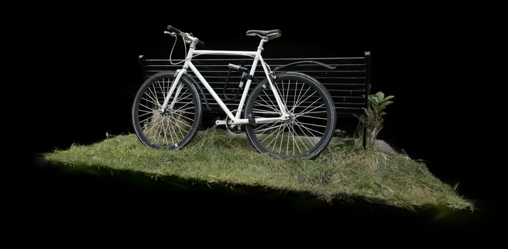

A real-time [3D Gaussian Splatting](https://repo-sam.inria.fr/fungraph/3d-gaussian-splatting/) viewer written in TypeScript and WGSL. It loads a trained scene (a `.ply` file holding about a million colored, semi-transparent 3D gaussians) and renders it in the browser from any viewpoint. The bicycle scene above renders in **6.1 ms of GPU time per frame** at 1280 × 720 on a laptop RTX 4050.

The viewer has two complete rasterizers:

- **Quad renderer.** Gaussians are projected in a compute pass, depth-sorted on the GPU, and drawn as instanced quads with hardware blending through one indirect draw call.
- **Tile renderer** (extra credit). It works like the paper's CUDA rasterizer: gaussians are binned into 16 × 16 pixel tiles, sorted per tile, and composited front to back in a compute shader.

It also includes an **f16 preprocess shader** (extra credit), an **opacity-aware tight-bounds optimization** that makes the quad renderer 2× faster, **GPU timestamp profiling** in the UI, and **debug views** for every stage of the pipeline.

[**Live demo**](https://farisyahz.github.io/Project5-WebGPU-Gaussian-Splat-Viewer/) (bring your own scene file, see [Run locally](#run-locally)) | [**Feature video (MP4)**](docs/media/demo.mp4) | [Raw measurements](docs/benchmarks)

[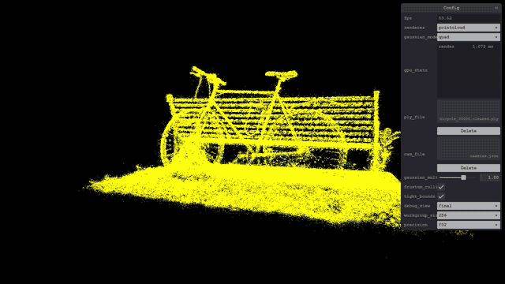](docs/media/demo.mp4)

## Contents

- [Run locally](#run-locally)
- [What the viewer renders](#what-the-viewer-renders)
- [The rendering pipeline](#the-rendering-pipeline)
- [Extra credit: tile-based rasterizer](#extra-credit-tile-based-rasterizer)
- [Extra credit: f16 preprocess](#extra-credit-f16-preprocess)
- [Optimization: tight splat bounds](#optimization-tight-splat-bounds)
- [Performance analysis](#performance-analysis)
- [Correctness](#correctness)
- [Implementation notes](#implementation-notes)
- [Reproduce the measurements](#reproduce-the-measurements)
- [Limitations and future work](#limitations-and-future-work)
- [Credits](#credits)

## Run locally

You need a browser with WebGPU; recent Chrome works best. On laptops with two GPUs, check on [webgpureport.org](https://webgpureport.org) that Chrome is using the discrete one.

```sh
npm install
npm run dev
```

Scene files are not part of the repository, because they are hundreds of megabytes. Download a scene folder (a `.ply` and its `cameras.json`) from the [course scene drive](https://drive.google.com/drive/folders/1Fz0QhyDU12JTsl2e7umGi5iy_V9drrIW?usp=sharing). Then drop the `.ply` on **ply_file** and the `cameras.json` on **cam_file**. Bicycle (`bicycle_30000.cleaned.ply`, 263 MB) takes about 40 s to parse; bonsai (`bonsai.ply`, 68 MB) takes about 10 s.

| Control | Action |
|---|---|
| Left drag | Look around |
| Right drag | Pan |
| Mouse wheel | Move forward / backward |
| 0–9 | Jump to one of the training camera poses |
| **renderer** | `pointcloud` or `gaussian` |
| **gaussian_mode** | `quad` (sorted instanced quads) or `tile` (tile-based compute rasterizer) |
| **gaussian_multiplier** | Scales every gaussian, 0 to 1.5 |
| **frustum_culling**, **tight_bounds** | Toggle the two culling optimizations |
| **debug_view** | Shows intermediate pipeline stages (see [below](#the-rendering-pipeline)) |
| **workgroup_size**, **precision** | Preprocess workgroup size (32 to 256) and f32 / f16 math |
| **gpu_stats** | Live per-stage GPU time from timestamp queries, plus visible gaussian and tile key counts |

The `fps` counter measures the `requestAnimationFrame` loop, so it is capped by the display's refresh rate. Use `gpu_stats` to compare settings.

## What the viewer renders

A Gaussian Splatting scene is the output of an optimization. Starting from about 200 photos of a real scene, training fits a cloud of 3D gaussians whose rendering reproduces those photos. Each gaussian is a soft ellipsoid, stored as 62 floats in the `.ply`:

| Property | Meaning | Use in the shaders |
|---|---|---|
| `x, y, z` | Center | Projected to the screen |
| `scale_0..2` | Log of the ellipsoid's radii | `exp`, times the GUI multiplier |
| `rot_0..3` | Orientation quaternion (w first) | 3D covariance |
| `opacity` | Logit of the peak opacity | `sigmoid` |
| `f_dc_*`, `f_rest_*` | 16 spherical-harmonic coefficients per color channel | View-dependent color |

The point cloud renderer uses only the centers. The gaussian renderer uses everything:

| Point cloud: 1.06 M centers, 1.1 ms | Gaussian splats: same data, 6.1 ms |
|---|---|
| 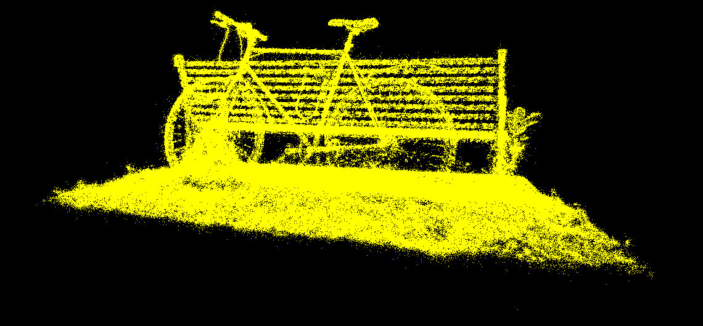 |  |

The loader packs each gaussian into 24 bytes of f16 data (position, opacity, rotation and scale) plus 96 bytes of f16 spherical harmonics. So bicycle occupies 127 MB of GPU memory.

## The rendering pipeline

Every frame runs these stages on the GPU:

| # | Stage | Kind | What it does |
|---|---|---|---|
| 1 | Reset | `queue.writeBuffer` | Zero the visible count and the sort's indirect dispatch size |
| 2 | **Preprocess** | Compute | Cull, project and shade every gaussian into a 2D splat; emit sort keys |
| 3 | **Sort** | Compute (provided radix sort) | Sort the visible splats by depth |
| 4 | Indirect args | `copyBufferToBuffer` | Copy the visible count into the draw call's instance count |
| 5 | **Render** | Vertex + fragment | One instanced quad per splat, alpha-blended back to front |

The CPU never reads anything back. The number of splats to sort and draw is decided on the GPU and passed to the sort and to the draw through indirect buffers.

### Preprocess: from a 3D gaussian to a 2D splat

One thread per gaussian:

1. **Culling.** Discard gaussians behind the near plane (view z < 0.2). Also discard those whose projected center falls outside 1.2× the screen bounds, so that splats near the edge still contribute.
2. **3D covariance.** Σ = R S Sᵀ Rᵀ, from the normalized quaternion and `exp(scale) × multiplier`.
3. **2D covariance.** EWA splatting: Σ' = J W Σ Wᵀ Jᵀ, where W is the view rotation and J the Jacobian of the perspective projection, evaluated at the gaussian center. As in the reference rasterizer, the center is clamped to 1.3× the field of view. Then 0.3 px² is added on the diagonal so every splat covers at least about one pixel.
4. **Conic and extent.** The conic is the inverse of Σ', used by the fragment shader. The quad extent comes from the eigenvalues (3σ) or from the [tight bounds](#optimization-tight-splat-bounds).
5. **Color.** Spherical harmonics up to degree 3, evaluated for the direction from the camera to the gaussian. Opacity = sigmoid(raw opacity).
6. **Output.** One `atomicAdd` reserves a slot. The splat is written there (32 bytes) together with a sort key and its index. Every 3,840 keys (256 threads × 15 keys per thread) the same thread also increments the sort's indirect `dispatch_x`.

The sort key is `~bitcast<u32>(view_z)`. Positive floats keep their order when reinterpreted as integers, and the bitwise inverse turns the radix sort's ascending order into the back-to-front order that blending needs.

### Rendering a splat

The vertex shader looks up `splats[sorted_index[instance]]` and expands a triangle-strip quad around the splat center. The fragment shader evaluates the gaussian at the pixel offset d from the center:

```
power = -½ (A dx² + C dy²) − B dx dy        (A, B, C) = conic
alpha = min(0.99, opacity · e^power)        discard if power > 0 or alpha < 1/255
```

Blending is `src-alpha, one-minus-src-alpha` with no depth buffer, valid because the splats arrive sorted back to front.

The `debug_view` option shows each step on its way to the final image:

| Quads (opaque) | Quad size (width, height as red, green; ×4) | SH color per quad |
|---|---|---|
|  | 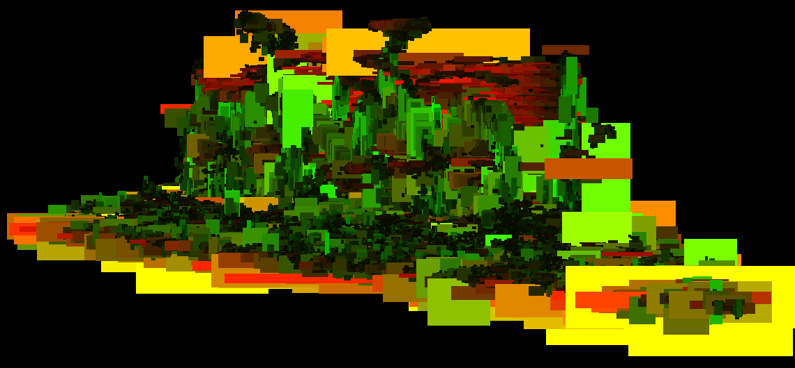 | 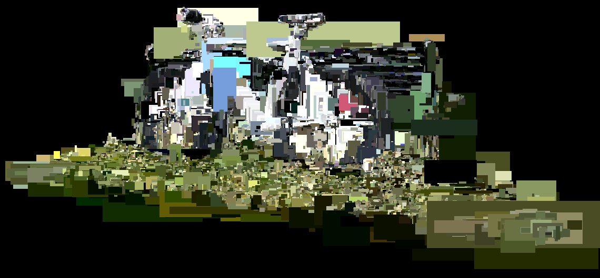 |
| **Pixel offset to the center (d.x, d.y)** | **Conic falloff and blending (final)** | |
| 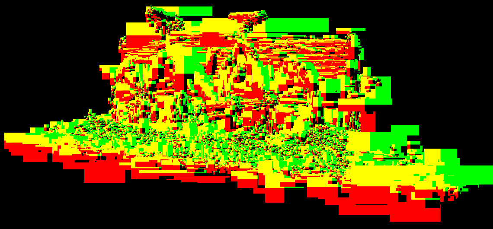 |  | |

`gaussian_multiplier` scales every gaussian before projection. At 0.25 the scene breaks into its individual splats; above 1 it smears:

| × 0.25 | × 0.5 | × 1.0 | × 1.5 |
|---|---|---|---|
|  | 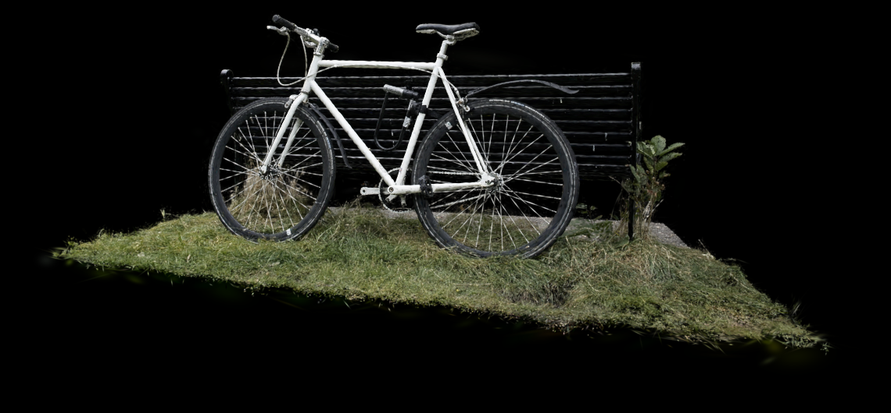 |  |  |

## Extra credit: tile-based rasterizer

`gaussian_mode: tile` replaces sorting and blending with the approach of the original paper:

1. **Duplicate.** `preprocess_tiles` projects each gaussian, then finds the rectangle of 16 × 16-pixel tiles that its splat touches. It reserves one key per tile with a single `atomicAdd`. A prefix sum isn't needed, because the keys are sorted afterwards anyway.
2. **Key.** Each key is `[tile id | depth]`. The provided radix sort handles 32-bit keys only, so the tile id takes the top ⌈log₂ tiles⌉ bits (12 at 1280 × 720, 13 at 1080p). The depth fills the remaining bits, taken from the top bits of the float's bit pattern without the sign. That is a free, logarithmic depth quantization with about 0.05% relative precision at 720p and 0.1% at 1080p. After an ascending sort, every tile owns a contiguous run of splats ordered front to back.
3. **Finalize.** One thread clamps the key count to the sort buffer capacity and writes the indirect arguments for the sort and for the next pass.
4. **Ranges.** For each sorted key, if the tile id changes from its neighbor, write the start or end of that tile's range.
5. **Rasterize.** One 16 × 16 workgroup per tile and one thread per pixel. The workgroup loads splats in batches of 256 into workgroup memory, and each thread blends them front to back in f32. A pixel stops once its transmittance drops below 10⁻⁴. The whole tile stops once all 256 pixels are done; it tracks this with a shared atomic counter that is broadcast with `workgroupUniformLoad`. The result goes to a storage texture, which a fullscreen triangle copies to the canvas.

| Tile renderer | Splats per tile (`debug_view: tile_heatmap`, log scale 1 to 8192) |
|---|---|
| 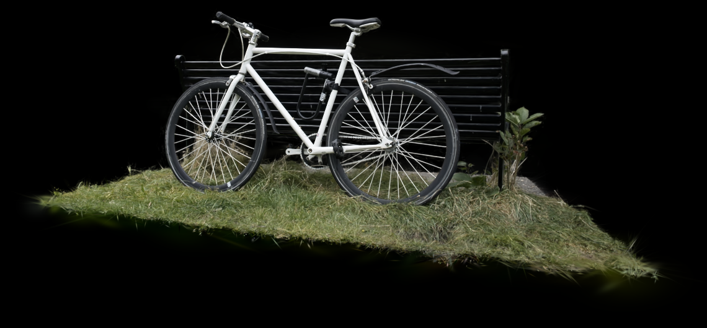 | 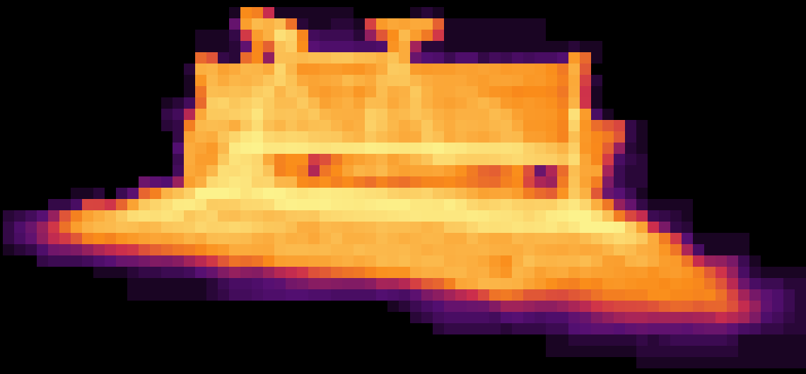 |

The heatmap shows why tiling matters. A tile over the bench and wheels has to process thousands of splats, while the background tiles have almost none. The sort buffers are sized for 8 keys per gaussian (16 M keys at most) and created only when tile mode is first selected. `gpu_stats` reports overflow if a view needs more. On bicycle, the default view needs 2.2 keys per visible gaussian.

On this GPU the tile renderer is slower than the quad renderer (11.0 vs 6.1 ms; see [the analysis](#quad-renderer-vs-tile-renderer)), but it produces a more accurate image, because it composites in f32 instead of an 8-bit framebuffer.

## Extra credit: f16 preprocess

`precision: f16` swaps the preprocess math for a half-precision version (`preprocess_f16.wgsl`, `enable f16;`, requires the `shader-f16` device feature). Both versions share the declarations and entry points, which are joined on the host, so only the math differs.

| Runs in f16 | Stays in f32, and why |
|---|---|
| Decoding the packed data (`bitcast<vec2<f16>>` straight from the u32s, no unpacking) | View and projection transforms: world positions and depths need the precision |
| Spherical-harmonic evaluation: 48 coefficients, most of the arithmetic | 2D covariance: entries reach about 10⁶ px², above the f16 maximum of 65,504 |
| Quaternion → rotation, 3D covariance | The conic: it is about 10⁻⁶ px⁻² for large splats, which is denormal in f16 |
| | Sigmoid: `exp(−x)` overflows f16 for raw opacities below −11 |

The 3D covariance needed one trick. A small gaussian has a scale around e⁻¹⁰, and its square underflows f16. So the shader computes R (S / s_max)² Rᵀ, where every entry lies in [0, 1] and s / s_max = exp(log s − log s_max) costs only one subtraction. It multiplies by s_max² after converting to f32.

The sigmoid row came from a measured bug. The first version evaluated the sigmoid in f16 too. For about 25,000 nearly transparent bicycle gaussians, the overflow made them skip the opacity cull, and they were sorted and drawn for nothing. Moving that single operation to f32 made the visible count match f32 exactly, and raised the f16 image quality from 54 to 64 dB PSNR.

The f16 image matches f32 within 64 dB PSNR, but it is not faster: preprocess takes 0.85 ms either way. The [workgroup-size study](#workgroup-size) explains why.

## Optimization: tight splat bounds

The reference rasterizer draws each splat as a square around a 3σ circle on its major axis. A thin, diagonal or faint splat therefore gets a quad that is mostly empty, and every fragment in it is evaluated and then discarded.

`tight_bounds` (on by default) shrinks each quad to the axis-aligned box of the region where alpha can still reach 1/255, because any fragment below that is discarded anyway:

```
k      = min(3, sqrt(2 · ln(255 · opacity)))      // σ at which opacity · e^(−k²/2) = 1/255
extent = ceil(k · (sqrt(Σ'xx), sqrt(Σ'yy)))       // exact bounding box of that ellipse
cull if 255 · opacity ≤ 1                         // the splat can never become visible
```

| Bicycle, default view | Reference 3σ square | Tight bounds | Change |
|---|---:|---:|---:|
| Splats drawn | 1,063,091 | 974,698 | −8% |
| Quad render pass | 7.59 ms | 2.21 ms | **3.4× faster** |
| Quad total GPU time | 11.85 ms | 6.08 ms | 1.9× faster |
| Tile keys | 5.00 M | 2.18 M | −56% |
| Tile total GPU time | 21.31 ms | 11.02 ms | 1.9× faster |
| Image difference | | | 75.5 dB PSNR (quad), max 4/255 |

The image stays the same (75 dB PSNR, no pixel differs by more than 4/255), while the quad renderer's frame time halves.

## Performance analysis

### Test conditions

- **Machine:** Windows 11, AMD Ryzen 7 8845HS, NVIDIA GeForce RTX 4050 Laptop GPU (driver 616.56).
- **Browser:** headless Chrome 155 with WebGPU on the NVIDIA adapter (the [environment record](docs/benchmarks/environment.json) has the full details).
- **App:** production build served by `vite preview`, canvas 1280 × 720.
- **Defaults:** unless stated otherwise, the bicycle scene from training camera 0, with tight bounds and frustum culling on, f32, and workgroup size 256.

A puppeteer script switches settings through the GUI and reads the `gpu_stats` monitor; it is in [scripts/bench](scripts/bench). Times come from `timestamp-query` around each pass. Each value is the mean of six readings of an exponential moving average, taken over 2.4 s after a 1.5 s settle. The sort time is measured from the end of preprocess to the start of rendering, so it also includes the small indirect-argument copy.

These are single-machine numbers, and one effect is worth knowing before reading them. Between sessions, the same configuration varied by up to about 0.1 ms. Very light workloads also read slow because the laptop GPU lowers its clocks: the point cloud of the 25% bicycle subset measured 2.2 ms, versus 0.5 ms for the 50% subset. Comparisons below use runs from the same session.

### Where the frame time goes

<picture>
  <source media="(prefers-color-scheme: dark)" srcset="docs/media/stage-breakdown-dark.png">
  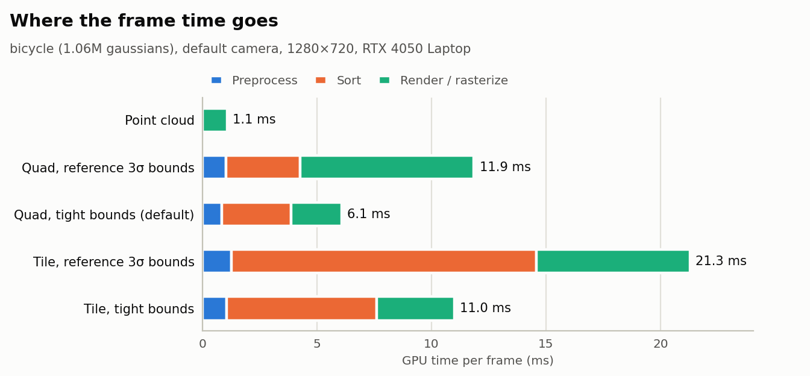
</picture>

| Renderer | Preprocess | Sort | Render / rasterize | Total |
|---|---:|---:|---:|---:|
| Point cloud | – | – | 1.08 ms | 1.08 ms |
| Quad, reference 3σ bounds | 1.03 ms | 3.23 ms | 7.59 ms | 11.85 ms |
| **Quad, tight bounds (default)** | 0.85 ms | 3.01 ms | 2.21 ms | **6.08 ms** |
| Tile, reference 3σ bounds | 1.27 ms | 13.32 ms | 6.70 ms | 21.31 ms |
| Tile, tight bounds | 1.07 ms | 6.53 ms | 3.40 ms | 11.02 ms |

### Point cloud vs gaussian renderer

The two renderers read the same buffer, but they do very different amounts of work:

- **Point cloud:** a single draw of 1.06 M one-pixel points, with no sorting and no blending. It costs 1.1 ms but shows only where the gaussians are: a hard yellow outline with holes, no color, and no surfaces.
- **Gaussian renderer:** each point becomes an oriented, view-dependent colored ellipse that must be composited in depth order. That adds three costs the point cloud doesn't pay:
  - preprocessing, which reads 120 bytes per gaussian;
  - a full radix sort, about half of the frame;
  - overdraw, because every pixel blends many overlapping, semi-transparent splats.

The result is photo-realistic, including view-dependent highlights from the spherical harmonics, at about 5.6× the point cloud's GPU time (6.1 vs 1.1 ms).

### Workgroup size

Preprocess GPU time (ms), bicycle. The f32 rows come from one session and the f16 rows from a second one:

| Workgroup size | 32 | 64 | 128 | 256 |
|---|---:|---:|---:|---:|
| Quad, f32 | 0.855 | 0.853 | 0.853 | 0.853 |
| Quad, f16 | 0.851 | 0.853 | 0.870 | 0.870 |
| Tile, f32 | 1.049 | 1.054 | 1.046 | 1.066 |
| Tile, f16 | 0.921 | 0.929 | 0.929 | 0.928 |

Workgroup size makes no measurable difference: the spread within each row is at most 0.02 ms, below the run-to-run variation. (The gap between the tile f32 and f16 rows comes from the separate sessions and isn't a precision effect.)

The preprocess shader is limited by memory bandwidth, not by how threads are grouped. Each gaussian costs 24 bytes of geometry, and each visible one another 96 bytes of spherical harmonics. On top of that, each visible splat writes 32 bytes plus an 8-byte sort entry. For bicycle that is about 120 MB read and 39 MB written per frame. In 0.85 ms that comes to **about 185 GB/s, close to the RTX 4050 Laptop's 192 GB/s peak**.

The shader uses no workgroup memory and no barriers. Every workgroup size from 32 (one NVIDIA warp) up therefore fills whole warps, and the scheduler keeps enough memory requests in flight to hide latency. Workgroup size would matter for a kernel that shares data within a workgroup, like the tile rasterizer, or on hardware with different warp or wave widths. The same bandwidth limit explains why f16 arithmetic doesn't speed the step up: it halves the cost of math that was never the bottleneck.

### Frustum culling

<picture>
  <source media="(prefers-color-scheme: dark)" srcset="docs/media/culling-dark.png">
  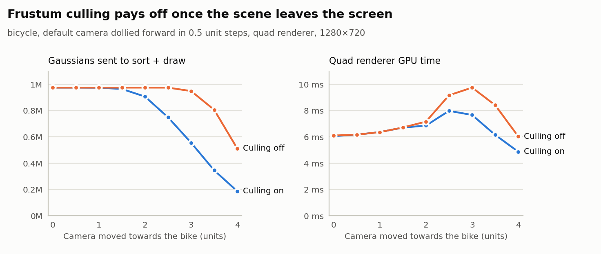
</picture>

From the training cameras, frustum culling changes nothing. All ten presets frame the whole object, so every gaussian is on screen, and the timings with and without culling match within noise.

To test it, the camera was moved toward the bike in 0.5-unit steps:

| Start of the sweep | 2 units in | End (4 units in) |
|---|---|---|
| 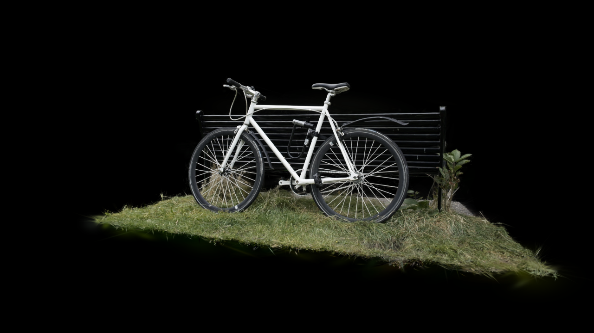 |  | 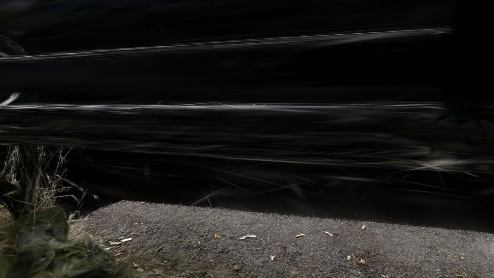 |

| Camera moved | Splats, culling on | Splats, culling off | GPU time, culling on | GPU time, culling off | Saving |
|---:|---:|---:|---:|---:|---:|
| 0 | 974,698 | 974,698 | 6.06 ms | 6.11 ms | 0% |
| 2.0 | 906,666 | 974,698 | 6.86 ms | 7.16 ms | 4% |
| 2.5 | 748,925 | 974,602 | 7.98 ms | 9.17 ms | 13% |
| 3.0 | 555,936 | 948,405 | 7.67 ms | 9.75 ms | **21%** |
| 4.0 | 187,728 | 512,032 | 4.88 ms | 6.04 ms | 19% |

Culling helps as soon as part of the scene leaves the screen, by up to 21% here. The savings come almost entirely from **sorting fewer keys**: at 3 units the sort drops from 3.62 to 2.22 ms, and preprocess from 0.85 to 0.56 ms because fewer splats are written. Rendering barely changes, because the GPU's clipper already discards off-screen triangles cheaply; the expensive work is everything before the draw.

Without culling the count still falls at the end of the sweep, because the near-plane test (view z < 0.2) is always on. Gaussians behind the camera are never sorted.

In tile mode the toggle has little effect (17.06 vs 16.82 ms at 3 units). A gaussian whose tile rectangle is empty emits no keys, so tile mode already culls off-screen splats as a side effect.

### Number of gaussians

<picture>
  <source media="(prefers-color-scheme: dark)" srcset="docs/media/gaussian-scaling-dark.png">
  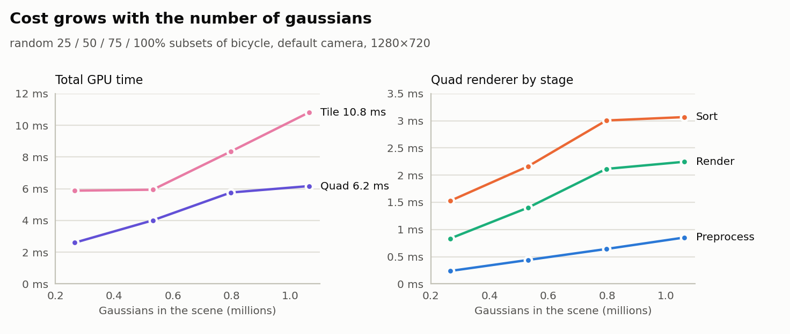
</picture>

To isolate the effect of scene size, random 25%, 50% and 75% subsets of bicycle were rendered from the same camera:

| Gaussians | Quad: preprocess | Quad: sort | Quad: render | Quad: total | Tile: keys | Tile: total |
|---:|---:|---:|---:|---:|---:|---:|
| 265,772 | 0.24 ms | 1.53 ms | 0.83 ms | 2.60 ms | 0.55 M | 5.88 ms |
| 531,545 | 0.44 ms | 2.16 ms | 1.40 ms | 4.01 ms | 1.09 M | 5.94 ms |
| 797,318 | 0.64 ms | 3.00 ms | 2.11 ms | 5.76 ms | 1.64 M | 8.35 ms |
| 1,063,091 | 0.85 ms | 3.07 ms | 2.25 ms | 6.17 ms | 2.18 M | 10.80 ms |

Yes, the number of gaussians drives the cost, and every stage scales with it:

- **Preprocess** is exactly linear (0.24 → 0.85 ms for 4× the gaussians), as a bandwidth-bound pass over the data should be.
- **Sort** grows with the number of keys. The radix sort does four passes over every key, plus fixed per-pass dispatch overhead.
- **Rendering** grows with overdraw. More gaussians from the same view means more overlapping splats per pixel.

At the light end the curves flatten, partly because of the clock scaling described in [Test conditions](#test-conditions). In tile mode, the sort also clears its key buffer up to the full capacity (8 keys per gaussian) every frame, which adds a cost even when few keys are used.

### Quad renderer vs tile renderer

The paper's tile approach exists to make CUDA rasterization fast. In this WebGPU implementation it is slower than the quad renderer (11.0 vs 6.1 ms), for two reasons:

- **Sorting 2.2× more keys.** One key per tile overlap means 2.18 M keys instead of 0.97 M, and the sort becomes 6.5 ms of the 11.0.
- **Hardware rasterization is very efficient.** Quads use the GPU's rasterizer and blending units (2.2 ms), while the compute rasterizer walks every splat of a tile in a shader loop (3.4 ms). The original implementation also benefits from CUDA-specific tools (64-bit-key radix sort, warp intrinsics) that the provided WebGPU sort doesn't have.

The tile renderer earns its place on accuracy. It composites in f32 with exact per-pixel early termination; the quad renderer accumulates in the 8-bit framebuffer, so its rounding errors compound layer by layer. It also has a fixed, predictable structure that a differentiable training pass could reuse. Wider tiles, subgroup operations and a fused range pass are the obvious next steps (see [future work](#limitations-and-future-work)).

## Correctness

Images were compared on the bicycle default view, 1280 × 720:

| Comparison | PSNR | Mean abs. error | Max error | Pixels off by > 8/255 |
|---|---:|---:|---:|---:|
| f16 vs f32 preprocess, quad | 63.9 dB | 0.025 | 5 | 0.000% |
| f16 vs f32 preprocess, tile | 65.2 dB | 0.015 | 24 | 0.001% |
| Tight vs reference bounds, quad | 75.5 dB | 0.002 | 4 | 0.000% |
| Tight vs reference bounds, tile | 71.5 dB | 0.002 | 16 | 0.001% |
| Quad vs tile renderer | 44.2 dB | 0.339 | 72 | 0.599% |

Both precisions and both bounds modes match closely. Quad and tile differ slightly, and the amplified (×10) difference image shows where:

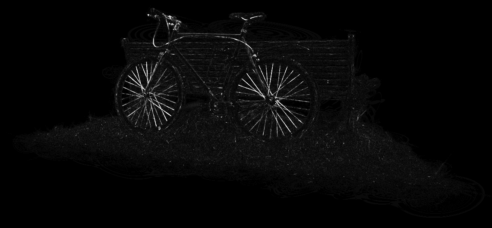

The differences concentrate on thin, bright structures such as the spokes and the frame, where many semi-transparent splats overlap. The faint rings in flat regions are 8-bit quantization bands from the quad renderer's framebuffer blending, which the tile renderer's f32 compositing doesn't have.

The debug views correspond to the assignment's milestone images (opaque quads, quad sizes, SH colors, pixel offsets), shown here from the default bicycle camera.

## Implementation notes

Some problems that shaped the code:

- **One preprocess module, two precisions.** The WGSL is assembled on the host: `preprocess_common.wgsl` (structs, bindings, helpers) + `preprocess.wgsl` or `preprocess_f16.wgsl` (math) + `preprocess_entries.wgsl` (the quad, tile and finalize entry points). The bind group layouts are explicit, so one set of bind groups serves every entry point, and bindings that a particular entry point doesn't use aren't stripped.
- **Storage buffer limit.** WebGPU guarantees only 8 storage buffers per shader stage. The tile path's splat counter, indirect dispatch and requested-key count share one buffer to stay within that limit on any device.
- **Workgroup count limit.** With small workgroups, a million gaussians needs more than 65,535 workgroups, so the preprocess dispatch switches to a 2D grid when needed.
- **Uniform control flow.** The tile rasterizer's batch loop contains barriers, so its trip count must be the same for the whole workgroup. Values loaded from storage buffers don't count as uniform, so the tile range is loaded by one thread and broadcast with `workgroupUniformLoad`.
- **Splat layout (32 bytes).** Color, opacity and quad size are packed as f16, but position and conic stay f32. An f16 conic is denormal for large splats, and an f16 NDC position jitters by about half a pixel at 1080p.

## Reproduce the measurements

The measurement data in [docs/benchmarks](docs/benchmarks) is plain JSON lines, one row per configuration. To regenerate the charts:

```sh
python -m pip install matplotlib
python scripts/plot_benchmarks.py
```

To re-measure, build and serve the app, then drive it with the harness:

```sh
npm run build && npx vite preview --port 5199
npm i --no-save puppeteer-core
python scripts/bench/gen_bench.py full shots > actions.json
RECORD_FILE=out.jsonl VIEW=1280x720 node scripts/bench/run.mjs http://localhost:5199/ <scene.ply> <cameras.json> actions.json
```

`scripts/bench/subsample.py` creates the random subsets used in the gaussian-count study.

## Limitations and future work

- **Sorting dominates both renderers.** The provided 32-bit radix sort runs four 8-bit passes over every key. A 64-bit key would remove the depth quantization in tile mode, and an 11-bit-digit sort or a sort that skips stable frames could cut its cost.
- **Tile mode clears its sort buffers up to the full capacity every frame**, and stores overflowing keys only up to that capacity (`gpu_stats` reports overflow). Sizing the buffers from the previous frame's key count would save memory and time.
- **The tile rasterizer uses no subgroup operations.** Larger tiles with subgroup ballots for early exit, or 2 × 2 pixels per thread, are the obvious next experiments.
- **View-dependent popping.** Like the reference, splats are sorted by their center's depth, so overlapping splats can swap order when the camera moves.
- **The results come from one laptop GPU in headless Chrome.** Clock scaling and run-to-run variation of about 0.1 ms limit the precision of small differences.
- **The live demo doesn't host scene files**; visitors load their own `.ply`.

## Credits

- **CIS 5650 starter project:** PLY loading, camera and camera presets, controls, the GPU radix sort (a WebGPU port of the Fuchsia Vulkan radix sort), the point cloud renderer and the GUI scaffold.
- **Paper:** Kerbl, Kopanas, Leimkühler and Drettakis, [3D Gaussian Splatting for Real-Time Radiance Field Rendering](https://repo-sam.inria.fr/fungraph/3d-gaussian-splatting/), SIGGRAPH 2023. Scenes trained with their method, from the course drive.
- **Formulas:** the [diff-gaussian-rasterization CUDA reference](https://github.com/graphdeco-inria/diff-gaussian-rasterization) and [kwea123's gaussian splatting notes](https://github.com/kwea123/gaussian_splatting_notes) for the covariance, projection and tile-rasterization formulas, and [BeatTheZombie's spherical harmonics post](https://beatthezombie.github.io/sh_post_1/) for the SH evaluation. The WGSL implementation, the tight-bounds optimization and the f16 scheme are my own.
- **Libraries:** [Vite](https://vitejs.dev/), [Tweakpane](https://tweakpane.github.io/docs/v3/), [wgpu-matrix](https://github.com/greggman/wgpu-matrix), [@petamoriken/float16](https://github.com/petamoriken/float16).
- **Tools (not part of the viewer):** [puppeteer-core](https://pptr.dev/) and Chrome for automated captures and measurements, Matplotlib for the charts, FFmpeg for the video.
