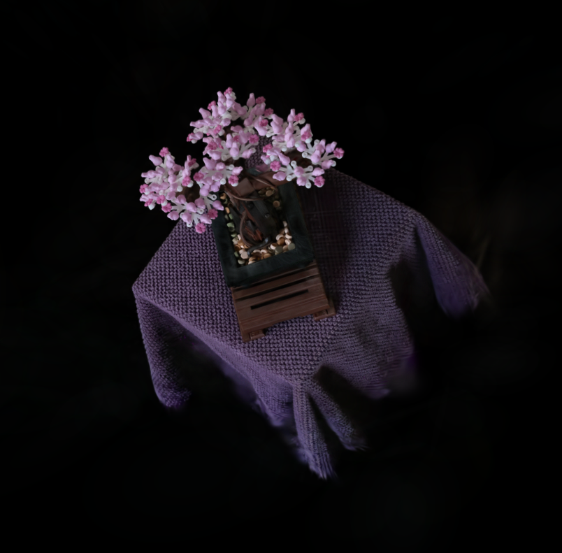
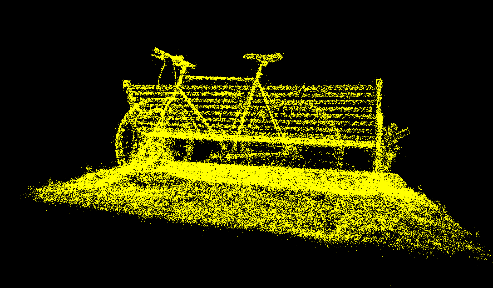
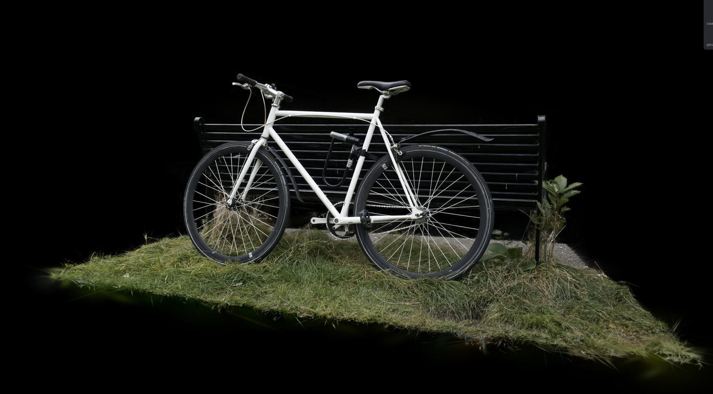
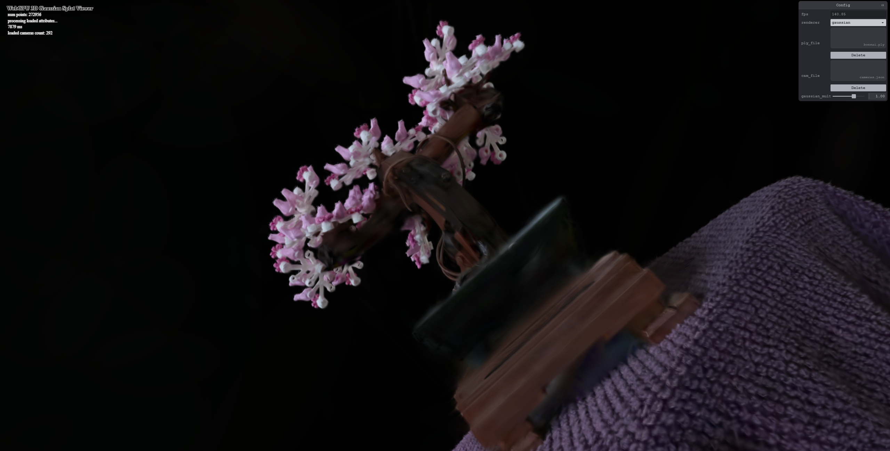

# Project5-WebGPU-Gaussian-Splat-Viewer

**University of Pennsylvania, CIS 5650: GPU Programming and Architecture, Project 5**

* Shanshan Wu
* Tested on: **Google Chrome 155.0.8059.80 (Official Build) (64-bit)** on
 Windows 11, AMD Ryzen 9 270 @ ~4.0GHz, 32GB RAM, NVIDIA GeForce RTX 5070 Laptop GPU (personal laptop)

### Live Demo

[Live demo](https://popi-x.github.io/Project5-WebGPU-Gaussian-Splat-Viewer/)

### Demo Video/GIF

[Demo Video](images/video.mp4)

<!-- or: [Demo video](images/demo.mp4) -->

---

## Overview

A real-time viewer for pre-trained [3D Gaussian Splatting](https://repo-sam.inria.fr/fungraph/3d-gaussian-splatting/) scenes, written in WebGPU (TypeScript + WGSL). A scene is a set of millions of 3D Gaussians, each with a position, scale, rotation, opacity, and view-dependent color stored as spherical harmonics. Every frame, each Gaussian is projected to a 2D ellipse ("splat") on screen, the splats are sorted by depth, and they are alpha-blended back to front.

The renderer has three GPU stages per frame:

1. **Preprocess (compute shader, one thread per Gaussian)**: frustum culling, 3D covariance, projection to a 2D covariance, conic and radius, spherical-harmonics color, and writing the depth key and index for sorting.
2. **Radix sort (provided)**: sorts the visible Gaussians by depth.
3. **Render (indirect instanced draw)**: one quad per visible Gaussian, in sorted order; the fragment shader evaluates the 2D Gaussian and the hardware blends the result.

## Features

### Part 1: Point cloud renderer
- MVP transform in the point cloud vertex shader.

### Part 2: Gaussian renderer

**Preprocess compute shader**
- View-frustum culling: Gaussians behind the camera or whose center falls outside a 1.2× enlarged NDC box are skipped.
- 3D covariance Σ = R S Sᵀ Rᵀ from the stored (log) scale and (normalized) rotation quaternion, with the GUI Gaussian multiplier applied to the scale.
- 2D covariance via the EWA approximation Σ' = J W Σ Wᵀ Jᵀ, with the Jacobian clamped to 1.3× the field of view and a 0.3 px² low-pass filter.
- Conic (inverse 2D covariance), radius from the largest eigenvalue (3σ), and quad size in NDC.
- View-dependent color from spherical harmonics (up to degree 3), read from the f16-packed SH buffer.
- Opacity recovered with a sigmoid.
- Stream compaction with `atomicAdd`: visible Gaussians append their depth key and index to the sort buffers, and the sort dispatch size is incremented once per 3840 keys.

**Sorting**
- Depth key `bitcast<u32>(far − z_view)`, so the ascending radix sort yields back-to-front order.
- Counters reset every frame with `queue.writeBuffer`.

**Rendering**
- Indirect draw: the visible count is copied from the sort info buffer into the `instanceCount` of the indirect draw buffer on the GPU, so the CPU never reads it back.
- Vertex shader reconstructs a screen-aligned quad around each splat from its NDC center and size.
- Fragment shader computes the pixel offset from the splat center, evaluates the Gaussian with the conic, discards fragments outside the ellipse or below 1/255 alpha, and outputs premultiplied color.
- Premultiplied alpha blending (`one`, `one-minus-src-alpha`).

### GUI
- Renderer switch (point cloud / Gaussian), PLY and camera file loading, Gaussian multiplier slider, number keys 0–9 for camera presets.

---

## Performance Analysis

**Setup:** resolution 1837 × 1317, scene and camera as noted in each table. FPS read from the on-screen monitor with Chrome's frame-rate limit disabled (`--disable-gpu-vsync --disable-frame-rate-limit`). Values fluctuated a lot, so ranges are shown; differences smaller than these ranges are within noise.

### 1. Point cloud vs. Gaussian renderer

| Scene | # Gaussians | Point cloud FPS | Gaussian FPS |
|---|---|---|---|
| bonsai | 272956 | 1000-5000 | 300-500 |
| bicycle | 1063091 | 1000-3333 | 1000 |

| Point cloud | Gaussian |
|---|---|
|  | 

**Differences.** The point cloud renderer is faster in both scenes: it draws one 1-pixel point per Gaussian, with no preprocessing, sorting, or blending. The Gaussian renderer runs a preprocess compute pass and a radix sort every frame, then draws a large, alpha-blended quad per visible Gaussian; these quads overlap heavily (overdraw), so its cost is dominated by rasterization and blending. The gap is smaller for bicycle because at its default camera the splats are small on screen.

### 2. Workgroup size (preprocess)

Scene: bonsai

| Workgroup size | FPS |
|---|---|
| 64 | 300 |
| 128 | 200-300 |
| 256 | 300-500 |

**Analysis.** All three sizes give FPS in the same range; the differences are within measurement noise. The preprocess pass is only a small part of the frame on this GPU, and the frame time is dominated by sorting and by rasterizing and blending the quads, so the workgroup size of the preprocess shader has little visible effect. All tested sizes are multiples of the 32-thread warp, so none leave lanes idle.

### 3. View-frustum culling

| Scene / view | Culling ON FPS | Culling OFF FPS | Visible / total Gaussians |
|---|---|---|---|
| bonsai, whole scene in view | 300-500 | 350 |  272956 / 272956  |
| bonsai, zoomed in | 200 | 150 | 203194 / 272956 |

**Analysis.** With the whole scene in view nothing is culled (272956 / 272956 visible), so ON and OFF perform the same within noise. When zoomed in, about 26% of the Gaussians are off screen; culling skips sorting and drawing them, raising FPS from about 150 to 200. The preprocess shader still runs for every Gaussian either way, so the gain comes only from less sorting and rasterization, and it grows as more of the scene leaves the view.

### 4. Number of Gaussians

| Scene | # Gaussians | FPS |
|---|---|---|
| bonsai | 272956 | 300-500 |
| bicycle (cleaned) | 1063091 | 1000 |
| bicycle (original, not cleaned) | ~6,130,000 | N/A (browser crashed while loading) |

**Analysis.** Bicycle has about 4× as many Gaussians as bonsai but runs faster at its default camera, so the count alone does not determine performance. Preprocessing and sorting scale roughly linearly with the number of Gaussians, but on this GPU they are cheap at these sizes; the dominant cost is fill rate. Bonsai's default view is close to the object, so its splats cover large parts of the screen and overlap heavily, while bicycle is seen from farther away with smaller splats.

I also tried the original bicycle scene (~6.1M Gaussians, 1.5 GB) to compare the same scene, but the browser crashed while loading it.

---

## Credits

- [Vite](https://vitejs.dev/)
- [tweakpane](https://tweakpane.github.io/docs//v3/monitor-bindings/)
- [stats.js](https://github.com/mrdoob/stats.js)
- [wgpu-matrix](https://github.com/greggman/wgpu-matrix)
